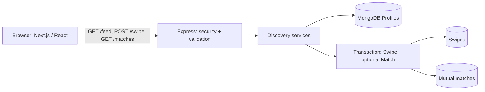

# Coy — Discover

A standalone, privacy-first discovery experience inspired by Coy's public brand. One profile at a time, quiet likes, and a reveal only when the feeling is mutual. Built for the Coy SDE Intern assignment using **Next.js App Router, React, TypeScript, Tailwind CSS, Framer Motion, Express, Zod, and MongoDB/Mongoose**.

## Run locally

Requires **Node.js 22.12+**, npm 10+, and MongoDB Community 7+ or an Atlas cluster. MongoDB must support transactions: use a replica set, even locally.

```powershell
npm ci
Copy-Item .env.example .env
```

Choose one database option:

- **Atlas:** Put an Atlas URI in `.env`, allow the backend's IP in Atlas Network Access, and create a database user with access only to the application database. Atlas already supports transactions.
- **Local helper:** Run `npm run db` in a separate terminal and leave it running. It starts a private, persistent single-node replica set on port **27018**, storing data in ignored `.runtime/mongodb`. Set `MONGODB_URI=mongodb://127.0.0.1:27018/coy_discover?replicaSet=coy-local` in `.env`. The helper uses `mongod` on PATH on macOS/Linux and MongoDB 7's standard install path on Windows. Set `MONGOD_BINARY` if installed elsewhere. It does not modify any MongoDB service running on port 27017.
- **Existing replica set:** Use the example URI with your replica set name. A standalone `mongod` is insufficient. The API checks this at startup and refuses to start with an unsupported database.

Then:

```powershell
npm run seed
npm run dev
```

Open **http://localhost:3000**. API: **http://localhost:4000**. The first seeded profile can demonstrate a mutual match. Seeding is idempotent and does **not** erase swipes or matches. Data remains in MongoDB after a frontend refresh, API restart, and database restart. Closing the database-helper terminal stops the local database; restart it to reuse the same data.

On macOS/Linux use `cp .env.example .env`. Do not commit `.env`.

## Features

- **Private discovery preferences:** use Preferences to pause/resume new introductions, choose a broad city, and select up to eight interests. Discovery includes people who share at least one selected interest; clear the selection to explore everyone. Preferences are saved in MongoDB, with no precise location or incoming-like hints. Pausing blocks new swipes server-side and preserves existing matches and choices. This pauses the single-account discovery experience; it does not claim visibility controls across real member accounts.
- **Optional conversation starters:** confirmed matches have a collapsible prompt in both the celebration and Matches view. A shared-interest prompt uses only your selected interests and the matched profile's public interests. Without an overlap, a neutral prompt makes no claim of shared interests. Prompts are saved with the match, so later preference changes do not rewrite them. Older matches receive a neutral fallback. Copy a prompt to use in your existing conversations.

- Home placeholder and fully functional Discover with internal For you / Matches navigation.
- 32 fictional adult profiles; 8 have privately expressed interest. Stock photos illustrate fictional identities.
- Mobile drag right/left with LIKE/PASS feedback, configurable 100px threshold, desktop buttons, and left/right keyboard shortcuts.
- Immediate finger-tracking and velocity-aware swipe exits, overlapped saving and animation, predecoded upcoming portraits, duplicate-input protection, and reduced-motion support. The next profile appears only after the server confirms the previous choice; failed saves spring the current card back.
- Full-screen accessible match dialog, focus restoration, confirmed matches grid.
- Loading skeletons, feed exhaustion, empty matches, image fallbacks, network errors/retry, toast feedback, duplicate/missing-profile recovery.
- Locally hosted font, wordmark, and stock images; no discovery image requests to third-party hosts.
- MongoDB transactions and unique compound indexes; fixed server-owned demo identity; strict public projections; no incoming-likes endpoint.

## Architecture



The frontend and API are separate applications. Components own presentation, `lib/api.ts` owns HTTP and typed responses, controllers validate requests, and services own feed and matching logic. MongoDB is the source of truth; localStorage is not used. Frontend state is only an in-memory view of server data.

```text
apps/
  web/
    src/app/              # App Router pages, layout, global design tokens
    src/components/       # Discovery, card, portrait, matches, match dialog
    src/lib/              # Typed API client
    src/assets/           # Local Bricolage Grotesque + font license
    public/               # Coy wordmark and cached stock portraits
  api/
    src/config/           # Validated env and fixed demo identity
    src/routes/           # Exact required API routes
    src/controllers/      # HTTP boundary and request validation
    src/validators/       # Strict Zod schema
    src/services/         # Feed, transactions, match retrieval
    src/models/           # Mongoose schemas, public projection, indexes
    src/middleware/       # Consistent sanitized errors
    src/scripts/          # Idempotent database seed
scripts/db.mjs            # Persistent local replica-set helper
docs/                     # Design research, asset sources, verification screenshots
```

## Environment

If an Atlas connection fails at `querySrv` because a local DNS resolver refuses the lookup, set the optional API-only `DNS_SERVERS=1.1.1.1,8.8.8.8` in the ignored root `.env`. This overrides DNS only for the API/seed process, without changing system networking. Leave it unset on hosting platforms whose normal resolver works.

The API reads the root `.env` regardless of workspace working directory. Process environment variables take precedence. Next.js reads `NEXT_PUBLIC_API_URL` from its own environment; localhost is the development default. For a nondefault frontend API URL, set it in **`apps/web/.env.local`** or the frontend host's build environment. Public Next.js variables are baked in at build time. The root `.env.example` documents all values but Next.js does not automatically read the monorepo root file.

| Variable              | Purpose                                                                     | Development default                                     |
| --------------------- | --------------------------------------------------------------------------- | ------------------------------------------------------- |
| `MONGODB_URI`         | Backend-only replica-set or Atlas connection                                | `mongodb://127.0.0.1:27017/coy_discover?replicaSet=rs0` |
| `PORT`                | API listening port                                                          | `4000`                                                  |
| `WEB_ORIGIN`          | Exact permitted frontend origin; comma-separated explicit origins supported | `http://localhost:3000`                                 |
| `NODE_ENV`            | `development`, `test`, or `production`                                      | `development`                                           |
| `NEXT_PUBLIC_API_URL` | Frontend's public API origin, without trailing slash                        | `http://localhost:4000`                                 |
| `MONGOD_BINARY`       | Optional helper path to `mongod` executable                                 | Platform-specific                                       |

There are no credentials in `.env.example`. Production startup requires an explicit database URI and non-local frontend origin. Never put the MongoDB URI in a `NEXT_PUBLIC_` variable.

## API reference

### Discovery preferences

`GET /preferences` returns `{ success: true, preferences: { paused: false, city: "", interests: [] }, options: { cities: [...], interests: [...] } }`. Options are a public seed catalog independent of incoming interest; no result counts are provided. Database identifiers are excluded.

`PUT /preferences` accepts exactly `{ "paused": false, "city": "Bengaluru", "interests": ["Coffee", "Photography"] }` and returns the saved preferences. Empty city means any city; interests use OR matching within that city. Unsupported values, duplicate interests, more than eight interests, or client-supplied identity return 400. CORS permits PUT. While paused, `/feed` returns no profiles and `/swipe` returns 409 with `DISCOVERY_PAUSED`; `/matches` stays available. Preferences are scoped to the server-owned demo identity and stored with a unique user index.

Actual mutual-match objects additionally include `conversationStarter: { interest: "Coffee", text: "..." }`. Its interest is `null` for a neutral prompt. It is never included in feed profiles or non-match responses, and its value persists after preferences change.

All required endpoints are mounted at the root, with no `/api` prefix. Reads return `Cache-Control: no-store`. The demo identity is fixed inside the backend; a client-supplied user ID is rejected by the strict swipe schema.

### `GET /feed`

```json
{
  "success": true,
  "profiles": [
    {
      "_id": "000000000000000000000001",
      "name": "Riya",
      "age": 23,
      "photo": "/portraits/0.jpg",
      "bio": "Collector of little moments...",
      "city": "Bengaluru",
      "college": "Srishti Institute",
      "interests": ["Coffee", "Photography", "Slow weekends"]
    }
  ]
}
```

Returns unswiped profiles only. Both passed and liked profiles are excluded. Profiles are sorted by stable public ID, independently of incoming interest. Photo paths are relative to the frontend asset origin.

### `POST /swipe`

```sh
curl -X POST http://localhost:4000/swipe -H "Content-Type: application/json" -d '{"profileId":"000000000000000000000001","direction":"like"}'
```

Windows PowerShell users can use:

```powershell
Invoke-RestMethod http://localhost:4000/swipe -Method Post -ContentType application/json -Body '{"profileId":"000000000000000000000001","direction":"like"}'
```

201 non-match (same shape for passes and non-mutual likes):

```json
{ "success": true, "matched": false }
```

201 actual mutual match:

```json
{
  "success": true,
  "matched": true,
  "match": {
    "id": "<match-id>",
    "createdAt": "<ISO timestamp>",
    "profile": {
      "_id": "000000000000000000000001",
      "name": "Riya",
      "age": 23,
      "photo": "/portraits/0.jpg",
      "city": "Bengaluru",
      "college": "Srishti Institute"
    }
  }
}
```

Invalid ID/body/direction or additional fields return 400. Missing profiles return 404. Repeated swipes return 409. Concurrent requests are protected by transactions and unique indexes. On a network failure the card stays; retrying an already committed request returns 409 and refreshes server state, including any confirmed match. Such a recovered match appears in Matches; its celebration is not replayed.

### `GET /matches`

```json
{
  "success": true,
  "matches": [
    {
      "id": "<match-id>",
      "createdAt": "<ISO timestamp>",
      "profile": {
        "_id": "000000000000000000000001",
        "name": "Riya",
        "age": 23,
        "photo": "/portraits/0.jpg",
        "bio": "Collector of little moments...",
        "city": "Bengaluru",
        "college": "Srishti Institute",
        "interests": ["Coffee", "Photography", "Slow weekends"]
      }
    }
  ]
}
```

Only confirmed matches for the demo user are returned, newest first. No incoming-like count or endpoint exists.

### Errors and health

```json
{
  "success": false,
  "error": { "code": "ALREADY_SWIPED", "message": "This profile has already been swiped." }
}
```

Other codes include `INVALID_INPUT` (400), `INVALID_JSON` (400), `PROFILE_NOT_FOUND` (404), `NOT_FOUND` (404), `BODY_TOO_LARGE` (413), `RATE_LIMITED` (429), and `SERVICE_UNAVAILABLE` (503). Database details and stack traces are never returned. `GET /health` returns 200 while connected and 503 otherwise. Database-dependent requests fail cleanly on connection loss.

## Data model and privacy

- **Profile:** name, age (minimum 18), photo, bio, city, optional college, interests, timestamps, private `hasLikedDemoUser`. The private field has `select:false`; public responses use an explicit allowlist as an additional boundary. The seed's 32 deterministic IDs make reseeding safe.
- **Swipe:** fixed userId, profileId, `like | pass`, createdAt. Unique `{userId, profileId}` index prevents repeat choices and supports feed exclusion.
- **Match:** fixed userId, profileId, createdAt. Unique `{userId, profileId}` index prevents duplicate matches. `{userId, createdAt:-1}` supports retrieval. Profile `_id` has MongoDB's default index for feed order/filtering.

The service reads the profile and preferences concurrently before starting the write transaction. The unique user/profile index rejects repeated swipes without a separate existence query. The transaction saves the swipe and inserts a match only if reciprocal interest is confirmed privately. A pass never creates a match. If inserting a match fails, the swipe rolls back. Incoming interest never affects public ordering, counts, tags, or non-match response shape. No fake compatibility percentage, online-status signal, or incoming-interest badge is displayed. Transactions require Atlas or a replica set.

This is intentionally a **single shared demo account** with no authentication. A public deployment allows everyone to modify that same account. It is an assignment demo, not a multi-user dating service. Rate limiting is in-process (120 requests/minute/IP); a scaled deployment would need a shared rate-limit store and real authentication. No user IDs, profile details, or incoming interest are trusted from frontend submissions. CORS is an origin restriction for browsers, not authentication.

## Development checks

```powershell
npm run typecheck
npm run lint
npm run format:check
npm run build
```

The repository does not include automated tests. For a manual demo, verify that a passed or liked profile stays excluded after refresh, a mutual match persists in Matches, and discovery preferences and pause/resume survive reload. Check the layout at mobile and desktop widths.

`npm run format` uses Prettier. `npm audit --omit=dev` checks shipped dependencies.

## Deployment: Vercel + Render + Atlas

For a personal assignment demonstration, choose Vercel Hobby, Render **Free**, and Atlas **Free** (formerly M0). The Render blueprint explicitly selects the free plan and Singapore region; choose a nearby supported Atlas region. Render Free sleeps after 15 minutes without inbound traffic and can take about a minute to wake. Open the API's `/health` page ahead of a live demonstration. The frontend's 12-second request timeout may show a retry state during that initial wake-up; retry once the API is ready. Database records survive because they live in Atlas, not Render's temporary filesystem. Free-tier limits and eligibility can change; check the providers' current dashboards before creating resources.

Render Free has no dashboard shell or one-off jobs. Seed Atlas from this checkout instead: temporarily point `MONGODB_URI` in your ignored root `.env` to the Atlas database, allow your current IP in Atlas Network Access, and run `npm run seed`. Restore the local URI afterward if you want to continue local work. Also allow Render's documented outbound IP ranges to reach Atlas. Do not paste credentials into the README or commit `.env`.

1. Provision an Atlas cluster, database user, and appropriate network access. Keep the URI in Render secrets.
2. Create a Render Node web service from the repository root. Build command: `npm ci && npm run build -w apps/api`. Start command: `npm run start -w apps/api`. Set `NODE_ENV=production`, `MONGODB_URI`, and `WEB_ORIGIN=https://<your-vercel-domain>`. Render supplies `PORT`. Set health check path `/health`.
3. Run `npm run seed` locally with the Atlas URI as described above (Render Free has no shell). It preserves existing state. Ensure indexes are created before accepting traffic (startup does this).
4. Import the monorepo into Vercel, choose the Next.js project with root `apps/web`, and keep access to the workspace root during install. Set `NEXT_PUBLIC_API_URL=https://<your-render-service>` **before building**. This must be the API's HTTPS origin, not the frontend URL. A standard root workspace install is `npm ci`; the frontend build is `npm run build -w apps/web` when run from the repository root.
5. Set the final frontend origin on Render. Use exact origins; avoid wildcard CORS. Add explicitly chosen preview origins only if you intend them to share the demo account.
6. Verify `/health`, feed loads, the first mutual like, a pass, and both kinds of reload persistence. No incoming-like data should appear in browser responses. No service has been provisioned or publicly deployed by this local implementation.

For a local production run, build first, then start the API and `npm run start -w apps/web` in separate terminals. Keep MongoDB running.

## Render keep-alive script

`scripts/ping-render.mjs` immediately pings `https://coy-9vf6.onrender.com/health`, then repeats every **14 minutes** while the process is running. It verifies HTTP success and `{ "success": true }`, retries temporary failures, and keeps running if a check fails. Requests never overlap, and request time is included in the interval. No GitHub Actions workflow is used.

Start the loop in a separate terminal:

```powershell
npm run keepalive
```

Keep that terminal and its computer running, or run the script on a separate always-on host. Stop it with **Ctrl+C**. Running it inside the same sleeping Render service cannot reliably wake that service.

For a single health check, run `npm run keepalive -- --once`. To use another endpoint, set the process environment variable `RENDER_HEALTH_URL` to the full health-check URL before starting the script.

This is a best-effort way to reduce inactivity shutdowns. Closing the terminal, computer sleep, network outages, or hosting limits can still interrupt checks. Keeping the service running remains subject to [Render's free-tier limits](https://render.com/docs/free#free-instance-hours).

## Design research and assignment scope

See [design notes](docs/design-notes.md) for the actual Coy tokens, public source references, assumptions, scope, and two Part A feature hypotheses. The assignment PDF is reference material. Authenticated app signup/OTP/email walkthrough and cloud deployment were not performed. The implementation follows the stricter MongoDB/Express/Next.js requirements in the user's pasted request. Asset sources and reuse considerations are in [assets](docs/assets.md).
